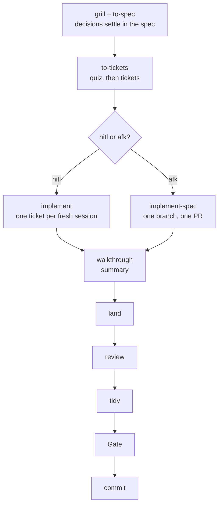

# Pairing workflow

I am the senior dev; the agent is the junior. The agent writes all code and tests. I make the decisions, review what matters, and tidy by hand where taste matters. I write code only by choice: a tidy after a review, or taking the pen when a build fails twice. The agent's own instructions live in `.omp/AGENTS.md`, `.omp/RULES.md` and the skills in `.omp/skills/` (symlinked into `~/.omp/agent/`); Matt Pocock's skills install to `~/.agents/skills` via `install.sh`. A diagram version of this page is [pairing-workflow.html](pairing-workflow.html), which the agent finds at `~/.omp/agent/pairing-workflow.html`, linked there by `install.sh`.

## The workflow at a glance

| Step | Skill | What I do | What the agent does |
|---|---|---|---|
| Decisions | `grill` + `to-spec` | Answer; settle the how choices that matter | Writes them into the spec's Implementation and Testing Decisions |
| Tickets | `to-tickets` | Quiz: override modes, answer `decision` questions, merge/split, approve once | Cuts vertical slices, sets mode and `**Human:**` trigger lines, quizzes me |
| hitl ticket | `implement` | Answers the shape review; sees the result for `see-it-run`; review, tidy, land at the end | Load → shape review (per trigger) → build (tdd) → self-review → Gate → walkthrough |
| afk tickets | `implement-spec` | Review and tidy on the PR | Builds all remaining afk tickets on one branch, opens one PR |
| Hand-over | `walkthrough` | Read the summary | Explains the change: Gate and a short summary in chat |
| Landing | `land` | Read the notes; review, tidy, pick | Writes the notes, asks the landing question, runs review → tidy → Gate → commit, then may suggest `calibrate` |
| Check | `calibrate` | Run when a spec closes | Reports drift and rework |

## hitl or afk

Every ticket has an explicit mode, set by `to-tickets` and overridable by me in the quiz:

- **hitl** (human in the loop): I review the ticket before it lands. On a tracker the mode is the label `ready-for-human`.
- **afk** (away from keyboard): the agent builds it start to finish; the review is offered at landing and I may skip it. Label `ready-for-agent`.

A ticket is hitl only when a mistake there gets expensive later. The triggers, and only these, make it hitl:

- **`structure`**: the ticket adds a new module, top-level directory, or a new kind of thing (a shape later code will copy), or places code across a module boundary where no existing example shows how. I answer "Is this the right place, and should it be new?" before the build.
- **`surface`**: the ticket adds or changes load-bearing surface: stored data (schema, migration, persisted file format, event format that outlives a deploy) or an outside contract (public API, CLI flags and output, published export, webhook payload, an interface outside code implements). I answer "Will this shape still be right in a year?" before the build. The concrete list lives once in `implement` § Surface.
- **`decision`**: a product or behaviour choice the spec did not settle and the agent would otherwise guess. The quiz settles it when possible; otherwise I pick an option in the shape review.
- **`see-it-run`**: UI, feel, or output I must react to. After the build I see the running result before landing.
- **`one-way-door`**: a deploy, a migration on real data, a sent message, or another irreversible outside action. I answer go or no-go immediately before it.

The first three stop at the **shape review** before the build. A ticket carries one line per trigger, directly under `**Mode:** hitl`:

    **Human:** structure: Is ConversationPin the right place, and should it be new?

Format: `**Human:** <trigger>: <specific question for this ticket>`. The question names the real thing, not the generic text. A hitl ticket with no `**Human:**` line is invalid. An afk ticket has no `**Human:**` line.

**Shape review**: the agent publishes one r3 page, one screen: the ticket and questions, the intent with acceptance examples, a **placement map** (a diagram of at most 9 boxes, each marked NEW, CHANGED, REUSED, REMOVED or STORED; each NEW box says why it is new), two checks picked for the trigger, and 1 to 5 decisions each with named options (A, B, ...). Every option carries one reasoning line: when and why a person would pick it, its main gain and its main cost. The reasoning is always shown, also when the agent's pick is hidden. When any trigger on the page hides its pick (`structure`, `one-way-door`), every pick on the page is hidden until I answer. A ticket whose only trigger is `decision` gets a shorter page: no placement map, just the ticket and questions, the intent, and the decisions. I answer with an option letter; a plain "yes" is not an answer. The build does not continue until every decision has an answer; if the review is archived with decisions still open, the agent asks in chat for the missing answers. How the page is built and drawn lives in `implement/PLACEMENT-MAP.md`.

Everything else is afk: internal code and types, refactors behind an unchanged contract, bug fixes, tests, config, and copies of a shape an earlier ticket established. Size, complexity, tests, and signature changes inside an existing module are not triggers: those tickets stay afk, and the PR review at landing catches a mistake there. Unsure, the agent recommends afk and says so in the quiz.

Ticket fields: What to build, Blocked by, Mode, `**Human:**` lines (hitl only), Status, acceptance criteria. There is no `Decisions` field: decisions live in the spec.

## How every ticket ends

**1. Walkthrough: the summary.** In chat, the agent gives the **summary**: what and why in one or two sentences, one diagram when a flow, state or structure changed, and the Gate line.

**2. Land: notes and the landing question.** The walkthrough then reads `skill://land`. `land` writes the **notes** (see Terms) and keeps them out of chat for now; zero notes is normal. Then it asks one question, saying how many notes there are:

- **hitl ticket (or ad-hoc implement)**: only **review, tidy, then commit** or **PR**. Review is required.
- **otherwise**: **commit** · **review, tidy, then commit** · **PR** · **leave it**. With at least one note, `land` recommends review, tidy, then commit (or PR for a multi-file or behavioural change) over commit.
- **work that already has an open PR** (after `implement-spec`): no question. `land` publishes to that PR (step 3) and gives me the URL; I review and tidy there.

**3. Publishing: where I read the code.** My answer decides where the summary and notes go:

- **review, tidy, then commit**: the diff goes to r3 against the start commit, with the summary and the files in reading order (entry point first, down the call path, tests beside the code they cover). The summary also lists the **defaults** (each choice the agent made without asking me, with the alternative as a question) and the **claims** (each claim with its proof, or marked "unverified"), the same lists the PR page carries; a long list reads better as a link to the PR section. Each note is a line note on its line; I resolve it to accept, or reply.
- **PR**: the summary is the PR body, with the reading order as a list of paths (GitHub sorts files alphabetically); each note is a review comment on its line.
- **commit or leave it**: the notes are printed in chat, one line each.

**4. Review and tidy** (for review, tidy, then commit):

- **Review**: I annotate the diff; the agent revises and replies until I archive it. It then proposes lessons, one line each, filed by kind: domain terms in `GLOSSARY.md`, general rules in `CODING_STANDARDS.md`, real tradeoffs as ADRs. It writes only the lines I accept.
- **Tidy**: offered once after the review. Where taste matters I refactor or delete anything myself and say "done". The agent reviews my edit as a pair; it edits my code only when asked. Then the Gate runs and the work commits.

**PR**: the same order on the PR. My review comments go first and the agent fixes them; then my tidy lands as my own commits on the branch, and CI checks them.

The order is always review → tidy → Gate → land. Review comes first, so I tidy settled code. My tidy is the last edit, so the agent never overwrites it. The Gate runs after my tidy, so it covers my change. On a PR the review and my tidy happen in their own session; `land` ends once the PR is published. When a `**Human:**` answer is still owed, it posts the open questions as one PR comment, and the merge waits on my answers. When the last open ticket of a spec lands, or a PR covers the spec's remaining tickets (after merging), `land` suggests running `calibrate` in a fresh session, in an onboarded repo that isn't a fork.

Commit identity: hitl and ad-hoc work commits as me via `commit_as_me`; afk work commits as the agent, conventional commit.

## Per-skill notes

### to-tickets

Cuts vertical slices against the spec's decisions and asks none of its own. A slice that needs an architectural or testing choice the spec left open is a spec gap: the agent raises it with me and the decision is added to the spec before slicing. It sets each ticket's mode and `**Human:**` lines per the section hitl or afk, with afk the default. Before publishing it **quizzes** me: the ticket list with title, blockers, what each delivers, mode, each `**Human:**` question, and why each hitl ticket needs a human stop. It settles `decision` triggers in the quiz when it can: each named option carries one reasoning line (when and why to pick it, gain and cost), and the answer goes into the spec. I override modes, add or drop triggers, merge or split, and approve once.

### implement

One ticket per fresh session. On a spec, the hitl tickets run first; the afk tickets can run one at a time here or together with `implement-spec`. The steps:

1. **Load**: the ticket, the spec's stories and Implementation and Testing Decisions, `CODING_STANDARDS.md`, `GLOSSARY.md`, the ADRs, and the start commit.
2. **Shape review**, for the triggers `structure`, `surface` and `decision` on the ticket's `**Human:**` lines: the agent publishes the one-screen r3 page; I answer each decision with an option letter; the build does not continue until each has an answer, and an archived review with open decisions sends the agent to chat for the missing answers. The agent applies the answers and edits later tickets that build on the agreed surface.
3. **Build** with tdd, to the options the shape review agreed. Done when every acceptance criterion has a passing test and no unimplemented bodies remain.
4. **See it run**, for the trigger `see-it-run`: after the build I see the running result (screenshot, recording, or real command output) and react; the agent fixes the real objections and shows again.
5. **Self-review** with code-review: a Standards reviewer and a Spec reviewer (the Spec one sees only the ticket, stories, diff, and the shape review's answers). Real findings get fixed; the rest become notes.
6. **Gate**.
7. **One-way-door**, for the trigger `one-way-door`: immediately before the irreversible action I answer go or no-go.
8. **Walkthrough**: see section How every ticket ends.

Without a ticket (ad-hoc work), the agent first proposes, in one `ask`, the how choices a spec would have settled and the triggers a ticket would carry, each with a one-line reason. Ad-hoc implement counts as hitl.

Mid-build surface needs: a new cross-module boundary, a new persisted data shape, or a change to an outside contract stops the build, runs the shape review, and records an ADR. Other public additions it makes and lists as notes.

**Take the pen**: a build worker fails twice on the same problem with no new hypothesis; the agent hands me the repro and the ruled-out hypotheses, and I take the pen or steer.

### walkthrough

Every task that changes files ends here. It explains the change: the Gate, then the summary, covered in section How every ticket ends. Then it always reads `skill://land`, passing the summary, the ticket reference, the mode, any open PR, and the points the agent kept for notes.

### land

Finishes the work. It writes the notes, then asks the landing question, or skips it when the work is already on an open PR. It publishes the summary and notes where I chose, runs the review and the tidy, then the Gate, and commits. It also runs on its own when I ask to land work. Details in section How every ticket ends.

## Pathways

I pick the entry point; nothing routes automatically.

| Starting point | Path |
|---|---|
| Huge or foggy | `wayfinder` → `to-spec` → `to-tickets` → `implement` per ticket |
| A feature in a repo | `grill-with-docs` (optionally `prototype`) → `to-spec` → `to-tickets` → `implement` per ticket |
| A plan or decision, no docs | `grill-me` |
| A bug | `diagnosing-bugs` → fix + regression test → `walkthrough` |
| A small, clear ask | just ask → `walkthrough` |
| Ad-hoc surface work, no ticket | `implement` (proposes the open decisions and the triggers first) |
| A spec with tickets left after the hitl ones | `implement-spec` (opens one PR; must not start while a hitl ticket is open) |
| After `implement-spec` | `walkthrough`, then `land` on its PR (land writes the end-of-work page into the PR body) |
| Before `implement-spec` starts | List the spec's open `ready-for-human` tickets; if any exist, stop and name them |
| An afk prep ticket that must land before a hitl ticket | `implement`, one at a time (`implement-spec` cannot start while a hitl ticket is open) |
| New repo for this workflow | `onboard` (runs `setup-matt-pocock-skills` first) |
| Workflow changed or older repo setup | `onboard` (upgrades it: old review entries in the retired formats migrate to `**Human:** <trigger>: <question>` lines, per `onboard/UPGRADE.md`; a hitl ticket with no trigger becomes afk after the user is told; a mode and label mismatch is relabelled) |
| Checking drift and rework | `calibrate` |
| A session felt clumsy; improve the agent's setup | `retro` (upstream) |

## Ask vs do

The agent asks me before anything hard to reverse or potentially harmful:

1. **publishing**: commit, push, tag, PR, merge;
2. deleting or overwriting work it didn't create, or rewriting git history;
3. changing persisted data, a public contract, or an external system (deploys, messages, paid services);
4. anything involving secrets or credentials.

Everything else it decides, states the assumption, and raises it as a note. Questions come batched in one `ask`.

## Terms

- **Gate**: the repo's one check command, in the agent file's `## Gate` section.
- **hitl / afk**: the two ticket modes. Defined once in section hitl or afk.
- **Load-bearing surface**: the stored data and outside contracts that make a ticket carry the `surface` trigger, section hitl or afk. The rest of the surface (module layout, public function heads and types, cross-module contracts) is surface but not load-bearing: it goes afk, and I review it in the PR.
- **Note**: a short comment the agent puts on one line of code, at most 25 plain words: what it did, then the other option as a question ("Retries use a fixed 1 s delay. Exponential backoff instead?"). It writes one only when I might want it done another way: a spot it is unsure of, an open review finding, an assumption, a choice that isn't obvious. I resolve it to accept, or reply. Where notes go is in section How every ticket ends.
- **Placement map**: the diagram in a shape review and on an end-of-work PR: at most 9 boxes, each marked NEW, CHANGED, REUSED, REMOVED or STORED; each NEW box says why it is new. Built by a `designer` subagent from a content brief. How: `implement/PLACEMENT-MAP.md`.
- **Review / Tidy**: the landing steps. Defined once in section How every ticket ends.
- **Shape review**: the one-screen r3 page the agent publishes before the build for the triggers `structure`, `surface` and `decision`. Defined once in section hitl or afk.
- **Stack pack**: `rule://stack-<name>`, what is true of every repo in a stack (e.g. `stack-elixir`, `stack-typescript`).
- **Surface**: module layout, public function heads and types, persisted data shape, cross-module contracts.
- **Trigger**: one of the five reasons a ticket is hitl (`structure`, `surface`, `decision`, `see-it-run`, `one-way-door`), carried on the ticket as a `**Human:**` line. Defined once in section hitl or afk.

## Diagrams

The agent draws diagrams with d2 through `bin/diagram`, which `install.sh` links into `~/.local/bin`. The script checks the same environment variables omp uses to decide whether it can show images (set by Ghostty, kitty, WezTerm and iTerm2; zellij passes images through) and renders an SVG with readable font sizes. When images can't show (SSH, other terminals, or after you say an image didn't show), the agent uses mermaid instead. Text read elsewhere, like r3 summaries and PR bodies, also uses mermaid, which GitHub draws.

## Repo docs

Project knowledge has three homes, one kind each:

- `GLOSSARY.md` (repo root): the domain's terms, meaning what words mean in this project.
- ADRs (the repo's ADR directory): decisions with real tradeoffs, and why.
- `CODING_STANDARDS.md` (repo root): how code is written here, as one-line rules; its existence marks the repo as onboarded.

In `docs/agents/`:

- `calibration.md`: the `calibrate` log.
- `issue-tracker.md`: written by `setup-matt-pocock-skills`.

The Gate lives in the agent file's `## Gate` section.

In a fork, these live under `.omp/` (`.omp/GLOSSARY.md`, `.omp/CODING_STANDARDS.md`, `.omp/adr/`, `.omp/docs/agents/`, with the agent file at `.omp/AGENTS.md`), excluded from git.

## Worked examples

### A small fix

"Fix the typo in the missing-user API error." The agent edits the string and runs the Gate, then gives the walkthrough: one sentence on the fix and the Gate line; no notes. It asks commit · review, tidy, then commit · PR · leave it, recommending commit. I pick commit.

### Three afk tickets

`to-tickets` splits an internal logging utility into three tickets, none carrying a trigger, no `**Human:**` lines. Each runs in its own fresh session: load → build → self-review → Gate → walkthrough. On the last one the agent has an assumption worth a note (log level as a string; async flushing; JSON output), so it recommends review, tidy, then commit. The diff goes to r3 with the summary and the notes as line notes; I read them, resolve each, and archive the review. Then it offers the tidy, and I pick commit.

### A hitl ticket

A payments spec. While grilling, I settle a spec decision in Implementation Decisions: "retries live in the caller, not the adapter". `to-tickets` cuts ticket 02, the Stripe adapter, as a small hitl ticket with two `**Human:**` lines:

    **Human:** surface: Will the PaymentProvider interface still be right in a year?
    **Human:** structure: Is a payments/adapter module the right place for Stripe, and should it be new?

The `surface` trigger is there because the `PaymentProvider` interface is a contract other modules rely on, load-bearing surface. The `structure` trigger is there because ticket 02 is the first instance of a shape the PayPal and Adyen tickets copy. Those tickets are afk, blocked by ticket 02, and say in "What to build" that they follow that ticket's shape.

Ticket 02 runs with `implement`:

1. **Shape review**: the agent writes the `PaymentProvider` interface and the adapter module shape in the real files, bodies not implemented, then publishes the one-screen r3 page. It carries the intent with acceptance examples, a placement map (the `PaymentProvider` interface and `payments/adapter/` module marked NEW, each with a "Why new" line, the existing `Payment` model marked REUSED, `payments/adapter/stripe.py` marked STORED for the API key), and the decisions:
   - A: amount is a Money struct (type safety at the boundary; a conversion at every provider call); B: amount is an integer of minor units (simple and provider-shaped; the unit is convention, not the type).
   - A: the adapter lives in `payments/adapter/` (a home the PayPal and Adyen tickets copy; a directory before it earns one); B: it sits beside the existing gateway code (no new structure yet; the module boundary arrives later, with churn).
   I pick A for both, and archive the review. The agent applies the answers and edits the PayPal and Adyen tickets to match the agreed shape.
2. **Build**: tdd for the Stripe adapter and its test, following the spec's decision on retries.
3. **Self-review**: code-review; real findings fixed, the rest become notes.
4. **Gate**.
5. **Walkthrough**: the summary and the Gate line.
6. **Land**: it's a hitl ticket, so the landing question is only review, tidy, then commit or PR. I pick review, tidy, then commit. The diff goes to r3 with the files in reading order; the review carries the notes as line notes, one per item, and I resolve each as I annotate. It revises until I archive the review. It offers the tidy; I tidy one function myself and say "done"; it reviews my edit as a pair, then runs the Gate and commits as me.

With ticket 02 done, `implement-spec` builds the PayPal and Adyen tickets afk on one branch, following ticket 02's shape, and opens one PR. The PR body is the end-of-work page: after the summary it carries one placement map for the whole PR, the defaults the agent picked without asking, and each claim with its proof. The walkthrough hands over and `land`, seeing the open PR, writes the summary into the PR body and posts the notes as PR review comments on their lines, where I resolve or reply to them; then I tidy as my own commits on the branch.
