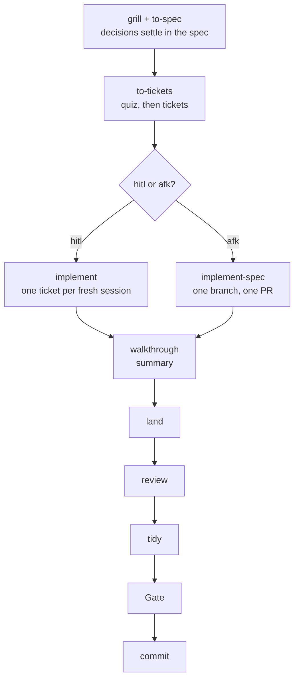

# Pairing workflow

I am the senior dev; the agent is the junior. The agent writes all code and tests. I make the decisions, review what matters, and tidy by hand where taste matters. I write code only by choice: a tidy after a review, or taking the pen when a build fails twice. The agent's own instructions live in `.omp/AGENTS.md`, `.omp/RULES.md` and the skills in `.omp/skills/` (symlinked into `~/.omp/agent/`); Matt Pocock's skills install to `~/.agents/skills` via `install.sh`. A diagram version of this page is [pairing-workflow.html](pairing-workflow.html), which the agent finds at `~/.omp/agent/pairing-workflow.html`, linked there by `install.sh`.

## The workflow at a glance

| Step | Skill | What I do | What the agent does |
|---|---|---|---|
| Decisions | `grill` + `to-spec` | Answer; settle the how choices that matter | Writes them into the spec's Implementation and Testing Decisions |
| Tickets | `to-tickets` | Quiz: override modes, add/drop reviews, merge/split, approve once | Cuts vertical slices, sets mode and review entries, quizzes me |
| hitl ticket | `implement` | Skeleton review if asked; review, tidy, land at the end | Load → skeleton → build (tdd) → self-review → Gate → walkthrough |
| afk tickets | `implement-spec` | Review and tidy on the PR | Builds all remaining afk tickets on one branch, opens one PR |
| Hand-over | `walkthrough` | Read the summary | Explains the change: Gate and a short summary in chat |
| Landing | `land` | Read the notes; review, tidy, pick | Writes the notes, asks the landing question, runs review → tidy → Gate → commit, then may suggest `calibrate` |
| Check | `calibrate` | Run when a spec closes | Reports drift and rework |

## hitl or afk

Every ticket has an explicit mode, set by `to-tickets` and overridable by me in the quiz:

- **hitl** (human in the loop): I review the ticket before it lands. On a tracker the mode is the label `ready-for-human`.
- **afk** (away from keyboard): the agent builds it start to finish; the review is offered at landing and I may skip it. Label `ready-for-agent`.

I require a review only where a mistake gets expensive later: in what stored data or outside code depends on (hard to undo once built on), or in code later tickets copy (the mistake multiplies). Everything else is cheap to fix in the PR, so it is afk.

There are exactly two review entries, set in the ticket's `Human` field:

- **`review: skeleton`**: the ticket adds or changes the **load-bearing surface**: stored data (DB schema or migration, persisted file format, message or event format that outlives a deploy) or outside contracts (public API endpoint, CLI flags and output, published library export, webhook or event payload, an interface outside code implements or calls). The build stops early to show me that surface (types, signatures, schema) before code is built on it. The concrete list lives once in `implement` § Surface.
- **`review: pattern <name>`**: the ticket builds the first instance of a shape (handler, adapter, migration, component) that two or more later tickets in this spec copy, with no existing instance in the codebase. I review and tidy it before any copying ticket starts; after it lands the agent proposes one `CODING_STANDARDS.md` line naming the file as the pattern's **reference instance**. Slicing: the pattern ticket is its own small hitl ticket; copying tickets are afk, blocked by it, and say they follow the reference instance from ticket NN.

Everything else is afk: internal code and types, refactors behind an unchanged contract, bug fixes, tests, config, and copies of a reference or existing instance. Size, complexity and risk alone keep a ticket afk. Unsure, the agent recommends afk and says so in the quiz. A hitl ticket with no review entry still gets the required review; an afk ticket drops its review entries.

Ticket fields: What to build, Blocked by, Mode, Human (review entries or "None"), Status, acceptance criteria. There is no `Decisions` field: decisions live in the spec.

## How every ticket ends

**1. Walkthrough: the summary.** In chat, the agent gives the **summary**: what and why in one or two sentences, one diagram when a flow, state or structure changed, and the Gate line.

**2. Land: notes and the landing question.** The walkthrough then reads `skill://land`. `land` writes the **notes** (see Terms) and keeps them out of chat for now; zero notes is normal. Then it asks one question, saying how many notes there are:

- **hitl ticket (or ad-hoc implement)**: only **review, tidy, then commit** or **PR**. Review is required.
- **otherwise**: **commit** · **review, tidy, then commit** · **PR** · **leave it**. With at least one note, `land` recommends review, tidy, then commit (or PR for a multi-file or behavioural change) over commit.
- **work that already has an open PR** (after `implement-spec`): no question. `land` publishes to that PR (step 3) and gives me the URL; I review and tidy there.

**3. Publishing: where I read the code.** My answer decides where the summary and notes go:

- **review, tidy, then commit**: the diff goes to r3 against the start commit, with the summary and the files in reading order (entry point first, down the call path, tests beside the code they cover). Each note is a line note on its line; I resolve it to accept, or reply.
- **PR**: the summary is the PR body, with the reading order as a list of paths (GitHub sorts files alphabetically); each note is a review comment on its line.
- **commit or leave it**: the notes are printed in chat, one line each.

**4. Review and tidy** (for review, tidy, then commit):

- **Review**: I annotate the diff; the agent revises and replies until I archive it. It then proposes lessons, one line each, filed by kind: domain terms in `GLOSSARY.md`, general rules in `CODING_STANDARDS.md`, real tradeoffs as ADRs. On a `review: pattern <name>` ticket it also proposes the reference-instance line. It writes only the lines I accept.
- **Tidy**: offered once after the review. Where taste matters I refactor or delete anything myself and say "done". The agent reviews my edit as a pair; it edits my code only when asked. Then the Gate runs and the work commits.

**PR**: the same order on the PR. My review comments go first and the agent fixes them; then my tidy lands as my own commits on the branch, and CI checks them.

The order is always review → tidy → Gate → land. Review comes first, so I tidy settled code. My tidy is the last edit, so the agent never overwrites it. The Gate runs after my tidy, so it covers my change. On a PR the review and my tidy happen in their own session; `land` ends once the PR is published. When the last open ticket of a spec lands, or a PR covers the spec's remaining tickets (after merging), `land` suggests running `calibrate` in a fresh session, in an onboarded repo that isn't a fork.

Commit identity: hitl and ad-hoc work commits as me via `commit_as_me`; afk work commits as the agent, conventional commit.

## Per-skill notes

### to-tickets

Cuts vertical slices against the spec's decisions and asks none of its own. A slice that needs an architectural or testing choice the spec left open is a spec gap: the agent raises it with me and the decision is added to the spec before slicing. It sets each ticket's mode and `Human` entries per the section hitl or afk, with afk the default. Before publishing it **quizzes** me: the ticket list with title, blockers, what each delivers, mode, review entries, and why each hitl ticket needs review. I override modes, add or drop reviews, merge or split, and approve once.

### implement

One ticket per fresh session. On a spec, the hitl tickets run first; the afk tickets can run one at a time here or together with `implement-spec`. The steps:

1. **Load**: the ticket, the spec's stories and Implementation and Testing Decisions, `CODING_STANDARDS.md`, `GLOSSARY.md`, the ADRs, and the start commit.
2. **Skeleton**, only with `review: skeleton`: written in the real files. I review it in r3; the agent revises, restructures included, until I archive the review.
3. **Build** with tdd, following the reference instance wherever the ticket names one. Done when every acceptance criterion has a passing test and no unimplemented bodies remain.
4. **Self-review** with code-review: a Standards reviewer and a Spec reviewer (the Spec one sees only the ticket, stories, skeleton and diff). Real findings get fixed; the rest become notes.
5. **Gate**.
6. **Walkthrough**: see section How every ticket ends.

Without a ticket (ad-hoc work), the agent first proposes, in one `ask`, the how choices a spec would have settled and any review entry, each with a one-line reason. Ad-hoc implement counts as hitl.

Mid-build surface needs: a new persisted data shape or cross-module contract stops the build, asks, and records an ADR. Other public additions it makes and lists as notes.

**Take the pen**: a build worker fails twice on the same problem with no new hypothesis; the agent hands me the repro and the ruled-out hypotheses, and I take the pen or steer.

### walkthrough

Every task that changes files ends here. It explains the change: the Gate, then the summary, covered in section How every ticket ends. Then it always reads `skill://land`, passing the summary, the ticket reference, the mode, any open PR, and the points the agent kept for notes.

### land

Finishes the work. It writes the notes, then asks the landing question, or skips it when the work is already on an open PR. It publishes the summary and notes where I chose, runs the review and the tidy, then the Gate, and commits. It also runs on its own when I ask to land work. Details in section How every ticket ends.

## Pathways

I pick the entry point; nothing routes automatically.

| Starting point | Path |
|---|---|
| Huge or foggy | `wayfinder` → `to-spec` → `to-tickets` → `implement` per ticket |
| A feature in a repo | `grill-with-docs` (optionally `prototype`) → `to-spec` → `to-tickets` → `implement` per ticket |
| A plan or decision, no docs | `grill-me` |
| A bug | `diagnosing-bugs` → fix + regression test → `walkthrough` |
| A small, clear ask | just ask → `walkthrough` |
| Ad-hoc surface work, no ticket | `implement` (proposes the open decisions and any review first) |
| A spec with tickets left after the hitl ones | `implement-spec` (opens one PR; must not start while a hitl ticket is open) |
| New repo for this workflow | `onboard` (runs `setup-matt-pocock-skills` first) |
| Workflow changed or older repo setup | `onboard` (upgrades it: `Puzzles` and `exemplar:` entries migrate to `review: pattern <name>`, mode set by the mode rule; tickets lacking Mode or Human get both; a mode and label mismatch is relabelled) |
| Checking drift and rework | `calibrate` |
| A session felt clumsy; improve the agent's setup | `retro` (upstream) |

## Ask vs do

The agent asks me before anything hard to reverse or potentially harmful:

1. **publishing**: commit, push, tag, PR, merge;
2. deleting or overwriting work it didn't create, or rewriting git history;
3. changing persisted data, a public contract, or an external system (deploys, messages, paid services);
4. anything involving secrets or credentials.

Everything else it decides, states the assumption, and raises it as a note. Questions come batched in one `ask`.

## Terms

- **Gate**: the repo's one check command, in the agent file's `## Gate` section.
- **hitl / afk**: the two ticket modes. Defined once in section hitl or afk.
- **Load-bearing surface**: the stored data and outside contracts listed in the review: skeleton entry, section hitl or afk. The rest of the surface (module layout, public function heads and types, cross-module contracts) is surface but not load-bearing: it goes afk, and I review it in the PR.
- **Reference instance**: the first reviewed and tidied instance of a copied shape, named by a `CODING_STANDARDS.md` line. Set in the review: pattern entry, section hitl or afk.
- **Note**: a short comment the agent puts on one line of code, at most 25 plain words: what it did, then the other option as a question ("Retries use a fixed 1 s delay. Exponential backoff instead?"). It writes one only when I might want it done another way: a spot it is unsure of, an open review finding, an assumption, a choice that isn't obvious. I resolve it to accept, or reply. Where notes go is in section How every ticket ends.
- **Review / Tidy**: the landing steps. Defined once in section How every ticket ends.
- **Skeleton**: the surface written as real code, bodies not implemented.
- **Stack pack**: `rule://stack-<name>`, what is true of every repo in a stack (e.g. `stack-elixir`, `stack-typescript`).
- **Surface**: module layout, public function heads and types, persisted data shape, cross-module contracts.

## Diagrams

The agent draws diagrams with d2 through `bin/diagram`, which `install.sh` links into `~/.local/bin`. The script checks the same environment variables omp uses to decide whether it can show images (set by Ghostty, kitty, WezTerm and iTerm2; zellij passes images through) and renders an SVG with readable font sizes. When images can't show (SSH, other terminals, or after you say an image didn't show), the agent uses mermaid instead. Text read elsewhere, like r3 summaries and PR bodies, also uses mermaid, which GitHub draws.

## Repo docs

Project knowledge has three homes, one kind each:

- `GLOSSARY.md` (repo root): the domain's terms, meaning what words mean in this project.
- ADRs (the repo's ADR directory): decisions with real tradeoffs, and why.
- `CODING_STANDARDS.md` (repo root): how code is written here, as one-line rules; its existence marks the repo as onboarded.

In `docs/agents/`:

- `calibration.md`: the `calibrate` log.
- `issue-tracker.md`: written by `setup-matt-pocock-skills`.

The Gate lives in the agent file's `## Gate` section.

In a fork, these live under `.omp/` (`.omp/GLOSSARY.md`, `.omp/CODING_STANDARDS.md`, `.omp/adr/`, `.omp/docs/agents/`, with the agent file at `.omp/AGENTS.md`), excluded from git.

## Worked examples

### A small fix

"Fix the typo in the missing-user API error." The agent edits the string and runs the Gate, then gives the walkthrough: one sentence on the fix and the Gate line; no notes. It asks commit · review, tidy, then commit · PR · leave it, recommending commit. I pick commit.

### Three afk tickets

`to-tickets` splits an internal logging utility into three tickets, none touching the surface, no `Human` entries. Each runs in its own fresh session: load → build → self-review → Gate → walkthrough. On the last one the agent has an assumption worth a note (log level as a string; async flushing; JSON output), so it recommends review, tidy, then commit. The diff goes to r3 with the summary and the notes as line notes; I read them, resolve each, and archive the review. Then it offers the tidy, and I pick commit.

### A hitl ticket

A payments spec. While grilling, I settle a spec decision in Implementation Decisions: "retries live in the caller, not the adapter". `to-tickets` cuts ticket 02, the Stripe adapter, as a small hitl ticket with `Human: review: skeleton` and `review: pattern payment provider adapter`. The skeleton entry is there because the `PaymentProvider` interface is a contract other modules rely on, load-bearing surface. The pattern entry is there because ticket 02 is the first instance of a shape the PayPal and Adyen tickets copy, with no existing instance in the codebase. Those tickets are afk, blocked by ticket 02, and say they follow the reference instance from ticket 02.

Ticket 02 runs with `implement`:

1. **Skeleton**: the agent writes the `PaymentProvider` interface and publishes it to r3. I annotate "amount should be a Money struct, not an integer"; it revises, and I archive the review.
2. **Build**: tdd for the Stripe adapter and its test, following the spec's decision on retries.
3. **Self-review**: code-review; real findings fixed, the rest become notes.
4. **Gate**.
5. **Walkthrough**: the summary and the Gate line.
6. **Land**: it's a hitl ticket, so the landing question is only review, tidy, then commit or PR. I pick review, tidy, then commit. The diff goes to r3 with the files in reading order; the review carries the notes as line notes, one per item, and I resolve each as I annotate. It revises until I archive the review. It proposes the `CODING_STANDARDS.md` line naming the adapter as the payment provider adapter pattern's reference instance; I accept, and it writes only that line. It offers the tidy; I tidy one function myself and say "done"; it reviews my edit as a pair, then runs the Gate and commits as me.

With ticket 02 done, `implement-spec` builds the PayPal and Adyen tickets afk on one branch, copying the reference instance, and opens one PR. The walkthrough hands over and `land`, seeing the open PR, writes the summary into the PR body and posts the notes as PR review comments on their lines, where I resolve or reply to them; then I tidy as my own commits on the branch.
