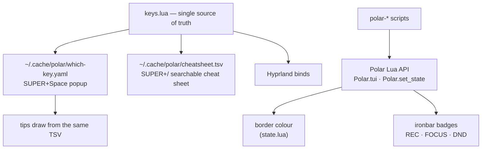

# Polar

A Nord-keyed Hyprland desktop: one leader key, every action reachable in two
presses, and the desktop itself tells you what state it is in (border colour,
bar badges, tips).

Polar runs on Arch desktops only — `install.sh` links `.config/hypr`,
`.config/ironbar`, `.config/mako`, `.config/fuzzel`, `.config/polar` and every
`bin/polar-*` script into `~/.local/bin` when it detects an Arch host with a
display. The config is Hyprland 0.56 Lua (`.config/hypr/*.lua`).

`keys.lua` regenerates the which-key popup and the cheat sheet on every reload,
so the keymap and its documentation cannot drift. Scripts like `polar-record`
and `polar-focus` call back into the config through `Polar.set_state` to change
the border colour and the bar.

## First 10 minutes

Log in. The wallpaper fades in, the ironbar appears at the top, and mako pops a
"Polar tip" — one keybinding hint per day.

1. **Open the leader menu:** press `SUPER+Space`. A popup lists every action
   with its key. Lowercase letter = terminal app (TUI), Shift+letter = its GUI
   counterpart (`a` wiremix vs `A` Pavucontrol, `b` btop vs `B` Mission Center,
   `f` yazi vs `F` Thunar).
2. **Open the cheat sheet:** press `SUPER+/`. Every binding, grouped and
   searchable. Type `shot`, press Enter — the action runs. This is the fastest
   way to learn a key: you never have to memorise anything.
3. **Try a drop-down:** `SUPER+Space t` drops a terminal over your work. Press
   `SUPER+Space t` again — it hides, but keeps running (shell history, btop
   scroll position, yazi directory all survive). The same works for `f` (yazi),
   `b` (btop), `a` (wiremix), `g` (lazygit).
4. **Move around:** `SUPER+hjkl` moves focus one step in that direction —
   between Hyprland windows, zellij panes, even nvim splits. At an edge it
   crosses into the neighbouring window, so one motion set covers the whole
   desktop. `SUPER+Shift+hjkl` moves windows, `SUPER+Ctrl+hjkl` resizes them.
5. **Focus mode:** press `SUPER+Z`. Gaps vanish, the bar hides, notifications
   mute, one window owns the screen. Press again to get the desktop back.
6. **Read the border:**

   | Border | Meaning |
   |---|---|
   | Nord blue gradient | normal |
   | Yellow (`#EBCB8B`) | a keyboard mode is waiting (e.g. resize) |
   | Purple (`#B48EAD`) | a special workspace (drop-down) is focused |
   | Red (`#BF616A`) | recording |
   | Orange (`#D08770`) | an urgent window wants attention |

7. **Watch the bar:** badges appear top-right while active — `FOCUS · Super+Z`
   (click to leave), `● REC · Super+Space r x`, `DND`, the resize mode name with
   a ` · Esc` hint, and a scratchpad label on the left showing which drop-down
   is up.

## Keymap

### Leader menu (`SUPER+Space`)

| Keys | Action |
|---|---|
| Return | terminal (ghostty) |
| space | launcher (fuzzel) |
| t | drop-down terminal |
| f | files (yazi) |
| F | Files (Thunar) |
| b | btop |
| B | Mission Center |
| a | audio (wiremix) |
| A | Pavucontrol |
| g | lazygit |
| w | Firefox |
| W | Chromium |
| c | clipboard history |
| s r / s w / s s | screenshot region / window / screen |
| r r / r s / r x | record region / screen / stop |
| n d / n x / n h | do-not-disturb / dismiss all / restore last notification |
| z | focus mode |
| v n | next wallpaper |
| m r | resize mode |
| p | power menu |
| ? | cheat sheet |
| h t / h o / h O | tip now / tips off / tips on |

### Direct binds

| Keys | Action |
|---|---|
| `SUPER+Return` | terminal |
| `SUPER+D` | launcher (fuzzel) |
| `SUPER+Space` | leader menu |
| `SUPER+`` ` `` | toggle drop-down terminal |
| `SUPER+Q` / `SUPER+F` / `SUPER+V` | close / fullscreen / float |
| `SUPER+mouse drag` | move window (left button) / resize (right button) |
| `SUPER+hjkl` | navigate left/down/up/right (windows, zellij, nvim) |
| `SUPER+Shift+hjkl` | move window |
| `SUPER+Ctrl+hjkl` | resize window |
| `SUPER+arrow keys` | focus window in that direction |
| `SUPER+1…0` | switch to workspace 1–10 |
| `SUPER+Shift+1…0` | move window to workspace 1–10 |
| `SUPER+/` | search the cheat sheet |
| `SUPER+Z` | focus mode |
| `SUPER+Escape` | lock screen (hyprlock) |
| `Print` | screenshot region |
| `XF86` volume keys | volume up/down, mute output/mic (work on the lock screen) |

## Testing checklist

Run through this after install or after editing the config.

| # | Do | Expect |
|---|---|---|
| 1 | Log in | ironbar at the top, wallpaper restored, a Polar tip notification, hypridle and mako running (`pgrep hypridle mako`) |
| 2 | `SUPER+Space` | which-key popup with all groups |
| 3 | Walk every leader entry (each submenu too) | each app/mode does what the popup says |
| 4 | Type `shot` in `SUPER+/` and press Enter | slurp selection starts — the cheat sheet runs actions |
| 5 | `SUPER+Space t`, then again | terminal drops over the screen, then hides but keeps shell history |
| 6 | Repeat for `f`, `b`, `a`, `g` | each opens a centred drop-down and keeps state when hidden |
| 7 | `SUPER+Space F` / `B` / `A` / `W` | GUI counterparts open as tiled windows |
| 8 | In a zellij nvim pane: `SUPER+h` at the left split edge | focus leaves nvim, then the zellij pane, then reaches the Hyprland window to the left |
| 9 | `SUPER+Space m r` | border turns yellow, bar shows `resize · Esc`; `hjkl` resizes, `Esc` exits and the border returns |
| 10 | `SUPER+Z` twice | gaps/bar/notifications off then back on; `FOCUS` badge appears |
| 11 | `SUPER+Space n d` | notifications muted, `DND` badge appears; toggle back |
| 12 | `Print` and `SUPER+Space s w` / `s s` | satty opens; Enter copies + saves to `~/Pictures/Screenshots`, Esc discards |
| 13 | `SUPER+Space r r`, record 5 s, `SUPER+Space r x` | border red + `● REC` badge while running; mp4 appears in `~/Videos/Recordings` |
| 14 | Copy text, then `SUPER+Space c` | fuzzel lists the clipboard entry; Enter pastes it back |
| 15 | `SUPER+Space p` → Lock | session locks (only the lock path is tested here; reboot/power-off confirm first) |
| 16 | `polar-wall nordify <image>` then `SUPER+Space v n` | image recoloured to Nord and shown; cycling crossfades to the next one |
| 17 | `SUPER+Escape`, type password | hyprlock unlocks |
| 18 | Idle 5 / 10 / 11 min | screen blanks at 5, locks at 10, DPMS off at 11; input resumes cleanly |
| 19 | `SUPER+Space h o` then `h O` | daily tips stop / resume (`h t` still shows one now) |

**If something fails:** `hyprctl configerrors` for config mistakes,
`hyprctl reload` to reapply (it also regenerates the cheat sheet). ironbar
logs to stderr under the session journal — `journalctl --user | grep -i ironbar`.
Navigation problems: `polar-nav <dir> --debug` prints each layer's decision.
A broken experiment can be rolled back from the installer's backup at
`~/.config/hypr.bak`.

## Customising

**Add a bind** — edit `.config/hypr/keys.lua`, the single source of truth:

- Leader entries go in the `leader` table: `{ key = "u", group = "Apps", desc = "update", cmd = "polar-update" }`. A `submenu = { … }` nests.
- Direct binds use `add({ chord = "SUPER + X", group = "…", desc = "…", action = hl.dsp.exec_cmd("cmd"), cmd = "cmd" })`. `action` is what runs; `cmd` is the shell form the cheat sheet displays.
- Reload: the which-key popup, cheat sheet and tips all regenerate from the same file.

**Add a scratchpad** — three places:

1. `state.lua`: add to `TUIS`, e.g. `notes = "ghostty --class=polar.tui.notes -e nvim"`.
2. `rules.lua`: add the name to the `polar-tui-*` loop list (float, centre, 70 % size, special workspace).
3. `keys.lua`: a leader entry `Polar.tui("notes")`. Hide it from the bar's dot row by adding `special:notes` / `notes` to the ironbar `hidden` list if wanted.

**Change colours or motion** — `.config/hypr/look.lua` owns gaps, borders, blur and dimming; `state.lua`'s `active_border()` owns the state colours and their precedence (recording → mode → urgent → special → normal); `motion.lua` owns tile movement behaviour.

**Add tips** — append a line to `.config/polar/tips.txt` as `title<TAB>body`. Keybinding tips need no entry: `polar-tip` draws them straight from the generated cheat sheet, so a new bind is teachable on day one.

## Known limits

- **Recording uses CPU encoding.** The distro FFmpeg needs NVENC API 13.1 while the NVIDIA driver exposes 13.0, so `gpu-screen-recorder` falls back to CPU encoding until the versions align (`bin/polar-record`).
- **Urgent border is a global flag.** `state.lua` keeps one `urgent` bool, cleared by any `window.active` event — not per-window — so the orange border cannot point at a specific window.
- **The resize badge is lowercase.** ironbar's `bindmode` shows the submap name (`resize`) verbatim; there is no format option to restyle it.
- **`Ctrl+L` in nvim no longer clears highlights.** The nav keymap in `.config/nvim/lua/config/keymaps.lua` maps `<C-l>` to cross-layer navigation, overriding LazyVim's default clear-highlight binding.
- **Zellij tab switching stays on `Alt+hjkl`.** `SUPER+hjkl` hands off to the compositor at a zellij pane edge and moves windows; only `Alt+hjkl` (`MoveFocusOrTab`) reaches the neighbouring tab.
