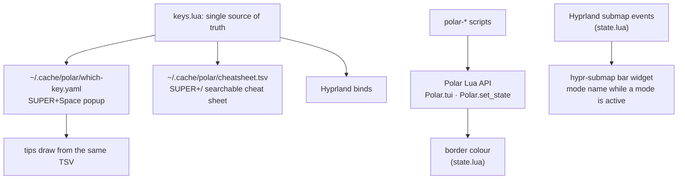

# Polar

A Nord-keyed Hyprland desktop: one leader key, every action reachable in two
presses, and the desktop itself tells you what state it is in (border
colour, bar widgets, tips).

Polar runs on Arch desktops only: `install.sh` links `.config/hypr`,
`.config/noctalia`, `.config/fuzzel`, `.config/polar` and every `bin/polar-*`
script into `~/.local/bin` when it detects an Arch host with a display. The
config is Hyprland 0.56 Lua (`.config/hypr/*.lua`). The shell is
[Noctalia](https://github.com/noctalia-dev/noctalia): it owns the bar,
notifications (with history), the OSD, the launcher, the clipboard, the
session and power panel, the wallpaper, the lock screen, idle handling and the
UI sounds.

`keys.lua` regenerates the which-key popup and the cheat sheet on every reload,
so the keymap and its documentation cannot drift. Scripts like `polar-focus`
call back into the config through `Polar.set_state` to change the border
colour.

## First 10 minutes

Log in. The wallpaper fades in, the Noctalia bar appears as one floating pill
under the top edge, and a "Polar tip" notification pops, one keybinding hint
per day.

1. **Open the leader menu:** press `SUPER+Space`. A popup lists every action
   with its key. Lowercase letter = terminal app (TUI), Shift+letter = its GUI
   counterpart (`a` wiremix vs `A` Pavucontrol, `b` btop vs `B` the
   process panel, `f` yazi vs `F` Thunar).
2. **Open the cheat sheet:** press `SUPER+/`. Every binding, grouped and
   searchable. Type `shot`, press Enter: the action runs. This is the fastest
   way to learn a key: you never have to memorise anything.
3. **Try a drop-down:** `SUPER+Space t` drops a terminal over your work. Press
   `SUPER+Space t` again: it hides, but keeps running (shell history, btop
   scroll position, yazi directory all survive). The same works for `f` (yazi),
   `b` (btop), `a` (wiremix), `g` (lazygit), `u` (bluetui) and `d` (dua):
   seven drop-downs in total.
   In the yazi drop-down, pressing `Enter` on a file hides the drop-down and
   opens the file in a normal window, so it stays visible when the drop-down
   comes back. A text file opens in nvim in a new ghostty window; other files
   open with `xdg-open`, and yazi keeps running in the drop-down.
4. **Move around:** `SUPER+hjkl` moves focus one step in that direction:
   between Hyprland windows, zellij panes, even nvim splits. At an edge it
   crosses into the neighbouring window, so one motion set covers the whole
   desktop. `SUPER+Shift+hjkl` moves windows, `SUPER+Ctrl+hjkl` resizes them.
   Workspace 9 runs the scrolling layout as a trial (see Look).
5. **Focus mode:** press `SUPER+Z`. Gaps vanish, the bar hides, notifications
   mute, one window owns the screen. Press again to get the desktop back.
6. **Read the border:**

   | Border | Meaning |
   |---|---|
   | Nord blue gradient | normal |
   | Yellow (`#EBCB8B`) | a keyboard mode is waiting (e.g. resize) |
   | Purple (`#B48EAD`) | a special workspace (drop-down) is focused |
   | Orange (`#D08770`) | an urgent window wants attention |

7. **Watch the bar:** the left end shows the workspaces, the submap name while
   a keyboard mode is active, and the media track with a spectrum beside it.
   The right end carries a recorder chip while a recording runs, the Claude
   Code and Neuralwatt usage percentages side by side, pending package updates
   (click for the updater panel), CPU and RAM percentages (click for the
   process panel), download speed, the tray behind one chevron, and the clock.
   The two usage percentages share one colour scheme: plain text normally,
   tertiary when running hot, red when nearly spent. Hover the download speed
   to unfold upload, listening ports and the LAN address (click to copy).
   There is no centre section: Noctalia does not push a centred section
   aside, so it overlapped the long right end.

## Keymap

### Leader menu (`SUPER+Space`)

| Keys | Action |
|---|---|
| Return | terminal (ghostty) |
| space | launcher (Noctalia panel) |
| t | drop-down terminal |
| f | files (yazi) |
| F | Files (Thunar) |
| b | btop |
| B | process panel (per-app CPU/RAM/GPU) |
| a | audio (wiremix) |
| A | Pavucontrol |
| g | lazygit |
| u | bluetooth (bluetui) |
| d | disk usage (dua) |
| i | invert window colours (Hypr-DarkWindow) |
| w | Firefox |
| W | Chromium |
| c | clipboard (Noctalia panel) |
| s r / s w / s s | screenshot region / window / screen |
| s o / s q / s m / s p | OCR text / QR code / measure / palette |
| r r / r s / r x | record region / focused screen / stop |
| n d / n x / n h | do-not-disturb / dismiss all / restore last notification |
| z | focus mode |
| v n | next wallpaper |
| m r | resize mode |
| p | session and power panel |
| ? | cheat sheet |
| h t / h o / h O | tip now / tips off / tips on |

### Direct binds

| Keys | Action |
|---|---|
| `SUPER+Return` | terminal |
| `SUPER+D` | launcher (Noctalia panel) |
| `SUPER+Space` | leader menu |
| `SUPER+`` ` `` | toggle drop-down terminal |
| `SUPER+Q` / `SUPER+F` / `SUPER+V` | close / fullscreen / float |
| `SUPER+mouse drag` | move window (left button) / resize (right button) |
| `SUPER+hjkl` | navigate left/down/up/right (windows, zellij, nvim) |
| `SUPER+Shift+hjkl` | move window |
| `SUPER+Ctrl+hjkl` | resize window |
| `SUPER+arrow keys` | focus window in that direction |
| `SUPER+1…0` | switch to workspace 1–10 |
| `SUPER+Shift+1…0` | move window to workspace 1–10 |
| `SUPER+Tab` | workspace overview (hyprexpo) |
| `SUPER+/` | search the cheat sheet |
| `SUPER+Z` | focus mode |
| `SUPER+Escape` | lock screen (Noctalia) |
| `SUPER+C` | pick colour from screen (screen-toolkit) |
| `Print` | screenshot region |
| `XF86` volume keys | `noctalia msg volume-up/down/mute` and `mic-mute` (work on the lock screen) |

## Volume and OSD

The volume keys go straight to Noctalia (`noctalia msg volume-up`,
`volume-down`, `volume-mute`, `mic-mute`), which changes the default sink or
source and draws its own OSD. The OSD sits top-centre with a 1.4 s hide delay,
and the same surface reports other shell state: Wi-Fi, Bluetooth, power
profile, night light and do-not-disturb (`[osd.kinds]` in
`.config/noctalia/config.toml`). The binds carry `locked = true`, so the keys
still work on the lock screen while the OSD itself stays out of the way there.
Noctalia follows PipeWire's default sink and source, so device switches behave
the same way.

## Plugins

The shell's extra widgets and panels are Noctalia catalog plugins. The
enabled list lives in `[plugins]` in `.config/noctalia/config.toml`, and
`install.sh` enables the same set with `noctalia msg plugins enable`. The
list must not declare a `[[plugins.source]]`: doing so replaces Noctalia's
built-in official and community sources, and no catalog plugin loads at all.

What the plugins add:

- **Bar widgets**: the Hyprland submap name while a keyboard mode is active
  (`hypr-submap`), column dots for workspace 9's scrolling layout
  (`scroll-indicator`), a Formula 1 marker, the Claude Code usage pill, the
  neuralwatt marker, pending package updates (`arch-updater`, whose panel
  upgrades in a terminal), listening ports with a stop
  control (`network-monitor`, speed display off because the built-in `sysmon`
  `net_rx`/`net_tx` widgets show it), the LAN address of the `en*` interface
  (`ip-monitor`, click copies it), and CPU and RAM meters whose left click
  opens the process panel.
- **Process panel**: `process-monitor` shows one row per app with its CPU, RAM
  and GPU use. It opens with leader `B` or by left-clicking the CPU or RAM bar
  widget.
- **Screen toolkit**: the colour picker behind `SUPER+C`, and leader
  `s o / q / m / p` for OCR, QR reading, measuring and palette extraction.
- **Recorder**: Noctalia's `screen_recorder`, driven by leader
  `r r / s / x` (start on a region, start on the focused screen, stop). Files
  land in `~/Videos/Recordings`, and its bar chip shows only while a
  recording runs.
- **Desktop widgets**: on an empty workspace, `clearclock` shows a large clock
  whose digits take their fill from the wallpaper beneath them, and
  `github-contributions-desktop` draws the GitHub contribution year under it.
  Both need `gh auth login` for the calendar data; `wallpaper_depth` masks the
  wallpaper's foreground over the widgets once its model is installed from
  its panel.
- **Others**: the Bitwarden vault, notes, a world clock, the `f1` widget, and
  `workspace-restore`, which reopens the apps you assign per workspace at
  login. The assignments and its "Restore at
  login" switch are configured in the plugin's panel.

Some plugins need a one-time setup in their settings (the gear in the panel):
an API key for `neuralwatt`, "Install model" for `wallpaper_depth`, and the
app list plus "Restore at login" for `workspace-restore`.

A plugin that misbehaves can be turned off by removing it from the
`[plugins].enabled` list and running `noctalia msg plugins disable
<plugin-id>`.

## Look

`.config/hypr/look.lua` and `rules.lua` give the desktop a consistent surface
treatment:

- **Glass**: Ghostty and the seven drop-down TUIs are translucent
  (background-opacity 0.94) and blurred by the compositor. Blur is global with
  `xray` on (it blurs the wallpaper layer only, so the cost is constant);
  normal windows opt out, while the layer surfaces that float over real
  windows (bar, launcher, notifications, OSD, which-key popup) turn `xray`
  back off per layer so they blur what is actually behind them. Noctalia
  animates its own surfaces, so Hyprland's layer animations are off for every
  shell namespace.
- **hyprglass trial**: the hyprglass plugin is installed but stays globally
  off. The `polar-glass-tui` and `polar-glass-float` rules tag the drop-down
  TUIs and floating windows with `hyprglass_enabled`, so only those get the
  plugin's one-pass `polar` preset (a low-cost blur with a light Nord tint)
  instead of Hyprland's blur. The tiled desktop keeps the cheap no-blur path.
  Turn the whole trial off with `hyprpm disable hyprglass`.
- **hyprfocus**: keyboard focus moves shrink the window slightly (3 %); mouse
  focus and group changes stay still, and floating windows are left alone so
  the drop-down TUIs do not wobble. The two plugin animations reuse Polar's
  springs.
- **Hypr-DarkWindow**: `SUPER+Space i` inverts the focused window's colours
  through a shader; the same dispatcher call toggles it back. Only the invert
  shader is loaded. An app that should always start inverted can get a rule in
  `rules.lua`; the example there is commented out.
- **Workspace 9 runs the scrolling layout** as a trial next to the tiling
  workspaces. Polar's window rules still apply and `SUPER+hjkl` moves focus
  along the tape. Two limits: with a fullscreen window, directional focus
  looks for another monitor instead of scrolling the tape (the layout's
  `focus` message is the way round it), and `SUPER+Ctrl+hjkl` still resizes in
  pixels rather than column widths.
- **Shadows**: floating windows get a soft shadow so they read against the
  wallpaper; tiled ones are flat, where a shadow is pure GPU cost on top of
  the dark seam the gaps already draw.
- **Quick-use apps**: the `polar-quick-float` rule in `rules.lua` opens
  Bitwarden, nwg-look and qt6ct floating and centred: they exist to do one
  thing and close, so they never take a tile. Bitwarden also gets a fixed size
  (30% of the monitor width, 65% of the height) from the
  `polar-bitwarden-size` rule.
- **Motion**: Noctalia owns the animation of its own surfaces (launcher,
  notifications, OSD, bar); Hyprland only animates windows, with the Polar
  springs. The bar never animates because it is permanent furniture.
- **Details**: the cursor hides while typing and returns on the next mouse
  move; the pre-wallpaper frame is Nord0 (`#2E3440`) instead of near-black.
- **GTK and Qt theming**: install.sh applies the Nordic theme (and
  Papirus-Dark icons, Nordzy cursors, dark colour scheme) through `gsettings`.
  Noctalia generates a Qt palette from its Nord theme; install.sh points qt6ct
  at `~/.config/qt6ct/colors/noctalia.conf` when the user has not chosen a
  scheme already. Apps pick the theme up after re-login.

## Wallpapers

Polar ships eight bundled full-frame wallpapers as SVGs in
`.config/polar/wallpapers/`: `signal-terrain`, `aurora-ranges`, `fjord-moon`,
`curl-current`, `ice-sheet-history`, `glacier-topo-network`, `circuit-horizon`,
`rack-city`. Each takes about 1–3 s to render, so the first run after adding
them takes a while.
`polar-wall next` and `polar-wall restore` render each one to a PNG in
`~/.local/share/polar/wallpapers` at the focused monitor's pixel size with
`resvg`, and only when the PNG is missing or older than its SVG, so login
stays cheap on later boots. That directory is the wallpaper directory Noctalia
reads; showing a wallpaper goes through `noctalia msg wallpaper-set`, and
Noctalia persists the choice itself (`polar-wall` only remembers the last file
so `restore` can pick it). Cycling uses Noctalia's transition pool (fade,
wipe, disc and friends, 900 ms), and `polar-wall nordify <image>` still
recolours any image into the Nord palette with `lutgen` and keeps it in the
same library, so custom wallpapers cycle alongside the bundled ones.

## Night light

Night light is Noctalia's `[nightlight]` in `.config/noctalia/config.toml`:
6500 K by day, 4500 K from 20:30 to 07:00 through `[location]` with
`custom_schedule = true`, so no coordinates are stored and the schedule holds
through midnight. The shell draws its own OSD when the temperature changes.

## Session and system

- **Noctalia as the session shell**: `autostart.lua` starts Noctalia once per
  login as a uwsm service with `Restart=on-failure`, so systemd brings the
  shell back if it crashes and it dies with the session. It owns the bar,
  notifications and their history, the OSD, the launcher and clipboard
  panels, the session and power panel, the wallpaper, the lock screen, idle
  handling and the UI sounds (freedesktop theme, at half volume).
- **Idle**: Noctalia blanks the screen at 5 minutes, locks at 10, and switches
  the panel off at 11 so the lock screen has drawn before the output goes
  dark.
- **Lock screen**: Noctalia's lock screen blurs and tints the desktop and
  fades in on lock and out on unlock. The lock and unlock hooks play a sound
  through PipeWire (`pw-play`), independent of the shell's own UI sounds.
- **Polkit**: `install.sh` runs `systemctl --user enable
  hyprpolkitagent.service`. The unit ships disabled, so without this no
  password prompt ever appears (mounting a drive, privileged GUI tools). It is
  a session service bound to `graphical-session.target`, not a Hyprland child,
  hence enabled at install rather than listed in `autostart.lua`.
- **Console palette**: `system/etc/vtrgb` and
  `system/etc/systemd/system/polar-console-palette.service` give the Linux
  console (ly on tty1 and the plain TTYs) the same Nord palette as the
  desktop; install.sh copies both to `/etc` with sudo and enables the unit.
  `system/etc/ly/startup.sh` sets ly's own VT over OSC P too, and the unit runs
  after `plymouth-quit` and before `ly@tty1`, because a VT that Plymouth still
  holds in `KD_GRAPHICS` ignores palette writes. It is a runtime unit rather
  than `vt.default_*` kernel parameters because those would live in the Secure
  Boot signed UKI's embedded cmdline and need a rebuild and re-sign on every
  palette change.
- **Noctalia settings**: the repo's `.config/noctalia/config.toml` is the
  base. The settings window (from the bar's session panel) writes runtime
  overrides to `~/.local/state/noctalia/settings.toml`, which loads last and
  wins. GUI settings therefore survive repo updates, and a setting that
  misbehaves should be looked for there before editing the repo file.

## Boot

The boot splash is Plymouth with the bundled `polar` theme, baked into the
Secure Boot signed UKI. The theme lives in
`system/usr/share/plymouth/themes/polar/` (`polar.plymouth`, the script
module, and PNGs rendered from committed SVG sources): a slowly rotating ring
of 24 frost dots with a trail, the Polar wordmark, and, on the LUKS prompt, a
masked bullet row under a "Disk passphrase" line. The background is Nord0 and
the ring turns a fixed step per refresh instead of tracking boot progress.

Two drop-ins feed mkinitcpio:

- `system/etc/mkinitcpio.conf.d/plymouth.conf` replaces the HOOKS array with
  the full order plus `plymouth` right after `systemd`, so it owns the console
  before `sd-encrypt` asks for the root passphrase.
- `system/etc/cmdline.d/10-polar-splash.conf` adds `quiet splash`. mkinitcpio
  concatenates every `/etc/cmdline.d/*.conf` into the UKI's `.cmdline`, so the
  splash parameters travel with the signed image; the loader entry's options
  no longer matter because systemd-boot boots the auto-discovered UKI entry.

`install.sh` carries a "Nord Plymouth boot splash" section that does the whole
chain: it installs the theme files and the two drop-ins to `/etc` and
`/usr/share`, sets `polar` as the default theme, copies the existing UKIs once
to `/var/lib/polar/uki-backup/` (`cp -an`, so a re-run never replaces the
first backup), runs `mkinitcpio -P`, then re-signs both UKIs with
`sbctl sign -s` (rebuilding drops the appended signature) and verifies with
`sbctl verify --json`. If the verification does not report both signed, the
install fails with exit 1 before the next boot instead of leaving a UKI that
Secure Boot refuses.

**Recovery.** Because `mkinitcpio -P` rebuilds both presets, the fallback UKI
is rebuilt with the splash too and is not a splash-free fallback. The
splash-free copies are the pre-splash images in `/var/lib/polar/uki-backup/`.
If the new UKI fails to boot, hold Space (or press Down) at the systemd-boot
menu and pick `arch-linux-fallback.efi`. If neither boots: boot the Arch ISO,
mount the ESP at `/boot`, and copy `/var/lib/polar/uki-backup/arch-linux.efi`
back to `/boot/EFI/Linux/arch-linux.efi` (it is byte-identical and still
signed). Alternatively remove the two drop-ins, run `mkinitcpio -P`, and
re-sign both UKIs.

## Packages

The desktop packages this depends on are in `packages/arch.txt`. Recent
additions: `noctalia` (the shell, which pulls in `adwaita-fonts` used by the
splash theme), `plymouth`, `bluetui` and `dua-cli`, plus, for the screen
toolkit and its helpers, `socat`, `python-pillow`, `tesseract` with
`tesseract-data-eng`, `zbar`, `imagemagick` and `qrencode`. The Bitwarden
plugin's `bw` comes from the AUR's `bitwarden-cli-bin` (`packages/aur.txt`),
a standalone binary, because the repo `bitwarden-cli` conflicts with the
system Node.
The Hyprland plugins
(hyprexpo, dynamic-cursors, Hypr-DarkWindow, hyprfocus, hyprglass) are not
packages: install.sh builds them from source with `hyprpm` against the running
compositor, and `hyprland-plugins` is a multi-plugin repository, so a retry
removes and re-adds the repository by name, not the plugin.

## Testing checklist

Run through this after install or after editing the config.

| # | Do | Expect |
|---|---|---|
| 1 | Log in | Noctalia bar as one floating pill, wallpaper restored, a Polar tip notification, Noctalia running (`pgrep noctalia`) |
| 2 | `SUPER+Space` | which-key popup with all groups |
| 3 | Walk every leader entry (each submenu too) | each app/mode/panel does what the popup says |
| 4 | Type `shot` in `SUPER+/` and press Enter | slurp selection starts: the cheat sheet runs actions |
| 5 | `SUPER+Space t`, then again | terminal drops over the screen, then hides but keeps shell history |
| 6 | Repeat for `f`, `b`, `a`, `g`, `u`, `d` | each opens a centred drop-down and keeps state when hidden |
| 7 | `SUPER+Space F` / `B` / `A` / `W` | GUI counterparts open as tiled windows |
| 8 | In a zellij nvim pane: `SUPER+h` at the left split edge | focus leaves nvim, then the zellij pane, then reaches the Hyprland window to the left |
| 9 | `SUPER+Space m r` | border turns yellow, bar shows the `resize` submap name; `hjkl` resizes, `Esc` exits and the border returns |
| 10 | `SUPER+Z` twice | gaps/bar/notifications off then back on |
| 11 | `SUPER+Space n d` | notifications muted, Noctalia's DND OSD appears; toggle back |
| 12 | `Print` and `SUPER+Space s w` / `s s` | satty opens; Enter copies + saves to `~/Pictures/Screenshots`, Esc discards |
| 13 | `SUPER+Space r r`, record 5 s, `SUPER+Space r x` | recorder chip in the bar while running; mp4 appears in `~/Videos/Recordings` |
| 14 | Copy text, then `SUPER+Space c` | Noctalia's clipboard panel lists the entry; Enter pastes it back |
| 15 | `SUPER+Space p` → session panel | power actions offered; Lock locks the session (only the lock path is tested here) |
| 16 | `polar-wall nordify <image>` then `SUPER+Space v n` | image recoloured to Nord and shown; cycling uses a Noctalia transition |
| 17 | `SUPER+Escape`, type password | the Noctalia lock screen unlocks |
| 18 | Idle 5 / 10 / 11 min | screen blanks at 5, locks at 10, DPMS off at 11; input resumes cleanly |
| 19 | `SUPER+Space h o` then `h O` | daily tips stop / resume (`h t` still shows one now) |
| 20 | Press volume up/down, then mute / mic-mute | Noctalia's OSD shows the change top-centre; the keys work on the lock screen |
| 21 | Delete a PNG in `~/.local/share/polar/wallpapers`, run `polar-wall next` | the PNG is re-rendered from its SVG at the monitor's size, then shown |
| 22 | After 20:30 (or temporarily set an earlier sunset in `config.toml`) | screen warms to 4500 K; Noctalia shows its night-light OSD |
| 23 | `SUPER+Space u` / `d` | bluetui and dua open as drop-downs with their own special workspace |
| 24 | `SUPER+Space i` twice on a window | colours invert, then restore |
| 25 | Open two windows on workspace 9, `SUPER+hjkl` | focus moves along the scrolling tape |
| 26 | Click between two tiled windows | the newly focused window shrinks briefly (hyprfocus), floating windows stay still |
| 27 | Open a drop-down TUI with hyprglass enabled | glass on the TUI and floating windows only; tiled windows stay blur-free |
| 28 | Cold boot | Nord ring and wordmark, no kernel text; LUKS prompt reads "Disk passphrase" with masked bullets; clean handover to ly with the Nord console palette |

**If something fails:** `hyprctl configerrors` for config mistakes,
`hyprctl reload` to reapply (it also regenerates the cheat sheet). Noctalia
logs to stderr under the session journal: `journalctl --user | grep -i
noctalia`. Navigation problems: `polar-nav <dir> --debug` prints each layer's
decision. A broken experiment can be rolled back from the installer's backup
at `~/.config/hypr.bak`.

## Customising

**Add a bind**: edit `.config/hypr/keys.lua`, the single source of truth:

- Leader entries go in the `leader` table: `{ key = "u", group = "Apps", desc = "bluetooth (bluetui)", cmd = lua_cmd('Polar.tui("bluetooth")') }`. A `submenu = { … }` nests.
- Direct binds use `add({ chord = "SUPER + X", group = "…", desc = "…", action = hl.dsp.exec_cmd("cmd"), cmd = "cmd" })`. `action` is what runs; `cmd` is the shell form the cheat sheet displays.
- Reload: the which-key popup, cheat sheet and tips all regenerate from the same file.

**Add a scratchpad**: three places:

1. `state.lua`: add to `TUIS`, e.g. `notes = "ghostty --class=polar.tui.notes -e nvim"`.
2. `rules.lua`: add the name to the `polar-tui-*` loop list (float, centre, 70 % size, special workspace) and, if it should get glass, to the `polar-glass-tui` class regex.
3. `keys.lua`: a leader entry `Polar.tui("notes")`. The special workspace shows up in the bar's workspace widget like any other occupied workspace.

**Change colours or motion**: `.config/hypr/look.lua` owns gaps, borders,
blur and dimming; `state.lua`'s `active_border()` owns the state colours and
their precedence (mode → urgent → special → normal); `motion.lua`
owns tile movement behaviour. The shell's colours are Noctalia's builtin Nord
theme in `.config/noctalia/config.toml`; changes made in the settings window
land in `~/.local/state/noctalia/settings.toml` and override the repo file.

**Add tips**: append a line to `.config/polar/tips.txt` as `title<TAB>body`.
Keybinding tips need no entry: `polar-tip` draws them straight from the
generated cheat sheet, so a new bind is teachable on day one.

**Add a bar widget**: the bar layout is `[bar.main]` in
`.config/noctalia/config.toml` (`start`, `center`, `end` widget lists); a
plugin widget is referenced as `type = "plugin-id:widget-id"`, and catalog
plugins are enabled under `[plugins]`. A widget's left-click action lives in
a `[widget.<name>.actions]` table, like the CPU and RAM meters that toggle
the process panel.

## Known limits

- **Urgent border is a global flag.** `state.lua` keeps one `urgent` bool, cleared by any `window.active` event (not per-window), so the orange border cannot point at a specific window.
- **Noctalia must be running for its IPC binds.** The launcher, clipboard, power, lock, DND, volume and wallpaper binds all go through `noctalia msg`; until the shell is up they do nothing (the scripts that need it guard with `command -v` and stay quiet).
- **The shell theme is fixed Nord.** `.config/noctalia/config.toml` pins `builtin = "Nord"`; only `~/.local/state/noctalia/settings.toml` overrides it.
- **hyprfocus and hyprglass are version sensitive.** `hyprland-plugins` pins stop short of the running Hyprland, so hyprpm builds main HEAD like it already does for dynamic-cursors; a plugin that fails to build stays off and install.sh warns.
- **hyprglass cost and opacity.** The glass effect multiplies the window's own alpha, so a window made translucent by a Hyprland `opacity` rule shows weak or broken glass (hyprglass issue 18); Ghostty's client-side `background-opacity` is the kind that works. The preset is deliberately one cheap blur pass on the GTX 1060.
- **`Ctrl+L` in nvim no longer clears highlights.** The nav keymap in `.config/nvim/lua/config/keymaps.lua` maps `<C-l>` to cross-layer navigation, overriding LazyVim's default clear-highlight binding.
- **Zellij tab switching stays on `Alt+hjkl`.** `SUPER+hjkl` hands off to the compositor at a zellij pane edge and moves windows; only `Alt+hjkl` (`MoveFocusOrTab`) reaches the neighbouring tab.
- **Scrolling workspace limits.** On workspace 9, directional focus with a fullscreen window jumps to another monitor instead of scrolling the tape, and `SUPER+Ctrl+hjkl` resizes in pixels, not columns.
- **The fallback UKI is not splash-free.** Both presets are rebuilt with the splash; only the pre-splash copies in `/var/lib/polar/uki-backup/` are. The systemd-boot preset's `--splash` Arch logo still paints before Plymouth.
- **The splash password prompt is masked bullets only.** Plymouth reports a count, not the characters; there is no way to show more.
